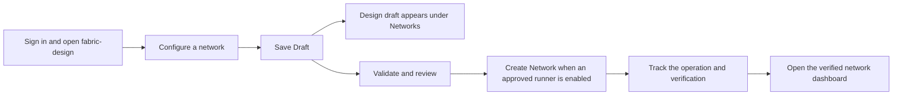

# Sathonate console guide

[Engineering handbook](../../fabric-control-plane/docs/engineering-handbook/README.md) · [Local deployment instructions](../../fabric-control-plane/docs/sprint1-secure-integration.md)

## What you can do in the current preview

The local console at [127.0.0.1:5173](http://127.0.0.1:5173/) connects to a real Go API and PostgreSQL database. The preview has **one saved design**, **Customer topology A**, in **fabric-design**. There are **zero Fabric deployments in that project**. I verified the saved design through the API.

A **design** is a stored blueprint. A **deployment** is an operation that uses that blueprint to create real Kubernetes and Fabric resources. A **verified network** is a deployment that has passed its runtime checks. These are separate steps.

This preview stops at the saved-design and review stages because the API was started with its deployment runner disabled. The runner is the backend process that would apply the design to an approved Kubernetes target. The existing retained network is a separate environment and is not connected to this preview project.

## 1. Sign in with the development token

The development token is a temporary password for this local preview. It is **not** an Okta password, an AWS credential, or a Fabric CA identity. You do not need to create an account for this preview.

1. Open the token file created for this Windows user at `%LOCALAPPDATA%\Sathonate\preview-session\preview-access.txt`. Copy its entire line. Keep it out of chats and screenshots.
2. Open the console and paste it in **Development token**. Click **Authenticate**.
3. Choose **fabric-design** in **Authorized project**, then click **Open project**. Authentication verifies the token. Opening the project selects the workspace whose designs the console should display.

The API hashes the token it receives and compares it with its server-side grant. A grant identifies the developer, tenant, project, permissions, and expiry. This preview grant permits reading and saving designs. It grants neither deployment permission nor access to the retained network. The original token is in the local handoff file, while the API grant stores its hash. The browser keeps the token in memory, so refreshing can require pasting it again. This token was issued for four hours. If it expires, request a new local grant.

## 2. Open the saved example or start a new design

- To see the example, click **Networks** in the workspace navigation, clear the search field, and open **Customer topology A**. Look for the **Design draft** badge. Use **Resume network design** if shown.
- To start fresh, click **Create Network** from **Networks**. This first button opens the wizard. It does not start a deployment.
- **Customer configurations** is the workspace area for configurable topology workflows. The dedicated visual builder and runtime actions depend on backend capabilities. A preview with execution disabled may hide or disable them.

## 3. Walk through the six wizard pages

### Step 1 · Project & Profile / Cloud Account

This screen shows **where the proposed network should run**. The authorized workspace is established by sign-in. In a secure local profile, the API owns the target and the console can show a fixed local profile. In other design modes, provider cards and non-secret references describe the intended target.

Check the project and target before continuing. **Test Connection** checks the configured path where supported. A connection check does not create a cluster or a Fabric network. Do not paste a cloud password, access key, or kubeconfig into a design field.

### Step 2 · Kubernetes Configuration

This screen shows **which Kubernetes environment would host Fabric**. With the secure local flow, the target comes from backend configuration. You cannot select an arbitrary cluster or namespace in that form. Other design profiles may show existing/new cluster choices, node configuration, networking and add-ons.

In this preview, the secure-local text describes the profile the wizard expects. Seeing it does not mean a runner or a disposable cluster is connected. Continue to design if you only want to review the blueprint.

### Step 3 · Network Design

This is the **Fabric blueprint**. The page groups:

| Section | What it controls |
|---|---|
| Network basics | Display name and design-level settings |
| Organizations | Participant groups and their identity boundaries |
| Peers | Nodes that endorse transactions and maintain ledger state |
| Orderers | Nodes that order transactions into channel blocks |
| Certificate authorities | Enrollment and identity material |
| Channels | Which organizations and nodes share a ledger |
| Chaincode | The smart contract definition intended for the channel |

On the fixed secure wizard, the **Secure network name** is editable and the qualified topology is shown with its fields locked. Customer-defined designs have separate configuration controls when the supported capability is available. **Validate**, where shown, checks the specification. **Save Draft** creates a database record, and **Save Changes** updates it. Return to **Networks** to see the saved design. Saving does not create pods, channels, or a ledger.

### Step 4 · Review & Cost Estimate

Review the configuration summary, infrastructure resources, topology preview, validation findings, and any cost assumptions. Go back to correct errors. The estimates describe the design, rather than a bill or approved cloud spend.

**Save Draft / Save Changes** keeps the blueprint. **Prepare Deployment JSON**, where shown for cloud design profiles, prepares a file. The **Create Network** button on this page submits deployment only when the design is valid and the selected backend runner is supported and enabled. If the runner is disabled, stop here after saving. Repeated clicks or another token will not enable deployment.

### Step 5 · Deployment Progress

This page needs a deployment operation ID. After a runner accepts a request, the page follows the recorded stages and events. In an enabled local Fabric flow, the worker prepares the target and identities, deploys orderers and peers, creates channels and joins members, then verifies the network and a transaction.

If a stage fails, open the operation and read its failure details before using **Retry**, where authorized. Recorded history can display completed stages from an earlier run; it does not establish present network health. The current preview has no deployment operation to show.

### Step 6 · Network Dashboard

This page opens after the deployment's verification gate succeeds. Depending on the profile and permissions, it shows workload and node health, channels, CAs, orderers, peers, chaincode, logs and supported operational controls. **Refresh Health** requests a current observation when the runtime is available.

A draft cannot populate this page. It has no Fabric workloads, health results, or committed transactions. If you see a **Deployment Verification** warning, go to **Deployment Progress** and check whether a real operation exists and succeeded.

## 4. Understand the workspace pages outside the wizard

| Page | What you should expect |
|---|---|
| **Networks** | Saved drafts and any recorded deployments in the open project. **Design draft** means saved. Check the project and search field if a card is missing. |
| **Customer configurations** | Dynamic design management and capability-dependent actions. Saving a configuration still produces a draft. |
| **Nodes** | Node inventory for an observed deployment. An empty view is expected for a draft. |
| **Chaincode** | Observed contract definitions for a deployment. A contract in a blueprint does not appear as committed. |
| **Operations** | Deployment and lifecycle history when the backend supports it. This preview has no deployment operations. |
| **Cloud readiness** | Checks and prerequisites for cloud execution. It does not create infrastructure. |
| **Customer account** | Trial, projects, invitations, invoices and usage when the customer pilot is enabled. It is outside this local preview. |

## 5. Why you cannot see a created network

| What you see | Meaning and next step |
|---|---|
| **No cards** in **Networks** | Confirm you opened **fabric-design** and clear any search. The authenticated API returned **Customer topology A** as revision 1 with status **draft**. |
| **Customer topology A — Design draft** | You found the saved blueprint. Open it to review the topology. It has not been deployed. |
| **Deployment runner is unavailable** | The current API can save designs but cannot start a worker. An operator must first pass the resource preflight and configure an approved disposable Kubernetes target, secure local runner, and appropriate deployment grant. |
| Empty **Nodes**, **Chaincode**, or **Operations** | The preview project has no deployment to observe. These pages will populate only after the corresponding runtime records exist. |

**To see the blueprint now:** sign in → open **fabric-design** → **Networks** → clear search → **Customer topology A**.

**To see a running Fabric network:** qualify and start an isolated secure local runner → open the authorized project → validate and review the design → submit **Create Network** on Step 4 → wait for Step 5 verification → open Step 6. The retained network stays separate throughout.

Sources: [wizard and workspace](../src/SmpApp.tsx) · [wizard screens](../src/SmpScreens.tsx) · [sign-in screen](../src/LocalSignIn.tsx) · [token validation](../../fabric-control-plane/internal/identity/local_tokens.go).

## Visual builder · Customer configurations

If the page heading is **Customer configurations** and the tabs run from **1 Network** to **6 Review**, you are in the visual design builder. Its six tabs edit a blueprint. The sixth tab reviews the topology; the separate deployment wizard has a runtime dashboard.

1. Under **Saved customer network**, select **Customer topology A** or choose **New customer configuration** for a separate design. **Import network JSON** can fill the builder from a design file.
2. Open **1 Network** to check the display name and network identifier.
3. Open **2 Organizations & CAs** to review each organization and its certificate authority.
4. Open **3 Peers & orderers** to review the peers and Raft orderers assigned to those organizations.
5. Open **4 Channels** to check membership and channel settings, then **5 Chaincode** to review the contract definition.
6. Open **6 Review** to inspect the topology summary. **Local completeness checks passed** refers to the browser's checks. Use **Save desired configuration** after editing to run server validation and persist the draft.
7. **Deploy saved network** starts real deployment only when the secure dynamic runner and grant are enabled. **Review running-network change** applies to an existing deployment. Both controls are disabled in the current preview.

I opened **6 Review** for **Customer topology A**, revision 3. The page showed two organizations, two peers, three orderers, two CAs, one channel, and one contract. The browser's completeness check passed. No design changes were needed for this walkthrough.
