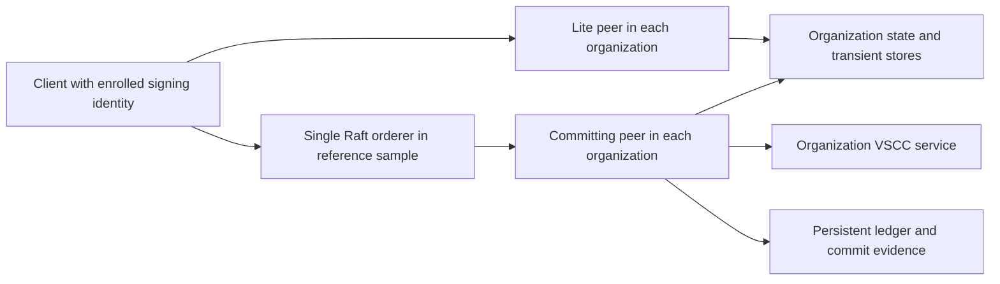

# Drunix v1.0.0 Kubernetes qualification

**Status: BLOCKED before provisioning.** Sathonate baseline `d34ba8d`,
verified on `origin/feature/drunix-foundation`. Qualification branch
`feature/drunix-deployment`. Upstream NPCI tag `v1.0.0` resolves to
`3fb2b135a5b2adf7e1071d9b1624052a1bbb1772`.

The foundation diff was reviewed after fetching. The
[`-compatibility-catalog` flag](../cmd/fabric-api/main.go#L50) defaults
to false. It conditionally registers one authenticated
[read-only route](../internal/httpapi/api.go#L40). Fabric deploy handlers,
manager, worker, operation storage and recovery do not consult the catalog.
See [discovery](drunix-discovery.md) and [foundation](drunix-foundation.md).

## Source-backed topology

This shows the reference application flow, not deployed Kubernetes objects.
The sample has two peer organizations, each with one lite peer
(`peer0`), one committing peer (`peer1`) and one validator
(`peer2` running `vscc node start`). The orderer sample uses etcdraft with
one orderer. It establishes no HA or quorum recovery claim.
[Sample procedures](https://github.com/npci/drunix/blob/v1.0.0/drunix-network/test-network/README.md) ·
[Compose topology](https://github.com/npci/drunix/blob/v1.0.0/drunix-network/test-network/compose/compose-test-net.yaml) ·
[Raft profile](https://github.com/npci/drunix/blob/v1.0.0/drunix-network/test-network/configtx/configtx.yaml).

| Boundary | Verified from source | Required before acceptance |
| --- | --- | --- |
| Certificates and identities | Fabric-style MSP membership, signing identities and TLS roots. The sample can generate development material with cryptogen or enroll using Fabric CA. | Fresh run-specific identities, correct MSPs, SANs matching Kubernetes DNS names, endpoint trust, explicit key handling and negative TLS tests. Sample crypto and enrollment defaults must not be reused. |
| Validation | Lite peer config points at its organization’s committer. The committer config enables the separate VSCC service and TLS, and sets its ingress name, service address and batch size. | Resolve stable service names, give the service its own identity, and verify correct TLS trust, failed endpoint handling and reconnect. Confirm valid and invalid transactions with the actual validator. |
| Storage | The documented sample uses per-organization YugabyteDB state and KeyDB transient storage. Peer and orderer Compose definitions mount ledger volumes. Source also describes LevelDB and CouchDB support. | Select one exact storage profile, map mounts and actual write paths, pin image and config for both stores, prove durable ledger and state across pod replacement. No claim of consistent restore across stores or supported storage migration. |
| Transactions | Upstream scripts create a channel, manage chaincode and provide separate invoke/query operations. Endorsement uses lite peers, then the orderer delivers blocks for validation, MVCC and commit. | Record tx ID, a committer-side valid status and the committed block height, then read the exact value. A successful submission or a query alone does not demonstrate the expected transaction committed. |

Sources: [design](https://github.com/npci/drunix/blob/v1.0.0/docs/drunix-arch.md),
[peer configuration](https://github.com/npci/drunix/blob/v1.0.0/drunix-network/config/peer/core.yaml),
[sample identities](https://github.com/npci/drunix/tree/v1.0.0/drunix-network/test-network/organizations),
[YugabyteDB and KeyDB Compose](https://github.com/npci/drunix/blob/v1.0.0/drunix-network/test-network/scripts/yugabyte/compose.yaml),
and [transaction helpers](https://github.com/npci/drunix/blob/v1.0.0/drunix-network/test-network/scripts/ccutils.sh).

## Artifact receipt

Registry reads confirmed these Linux/amd64 manifest digests on 16 November
2026. A registry response identifies a manifest. It does not establish
source-to-binary provenance, successful image pull, startup or compatibility.

| Source reference | Observed Linux/amd64 digest |
| --- | --- |
| `npcioss/drunix-peer:1.0.0` | `sha256:dac28b37f9bd724d34edb7f1c20ca5b987667efa3270809f2ed1507fcf5f754f` |
| `npcioss/drunix-orderer:1.0.0` | `sha256:991da76f33c87459667b9f815eb44fb63f160c9fb5dcb114ed7b70491c9fda7b` |
| `npcioss/drunix-vscc:1.0.0` | `sha256:9156b22fb4c9a02747d30515ec7e04183f246fea02df8edfc1d0821c496f6664` |
| `yugabytedb/yugabyte:2025.2.0.0-b131` | `sha256:0c55c2915e04596882d49ab15f6d9ef025c14e2a53525f6abc7d7feeb372f256` |
| `eqalpha/keydb:latest` | `sha256:eceb1806730c7850395b8262300182c2e15a6e5dacbf0b72cbab110518caf43f` |

The sample KeyDB reference floats and the optional CA compose file uses
`hyperledger/fabric-ca:latest`. Do not infer upstream test provenance from
either current tag. Select and verify exact dependencies before treating
them as a reproducible runtime set. The published `drunix.tar.gz` release
asset lists SHA-256
`006a568a2692e0b994b392551d4e87168b95cc0b3bfc8355c22fcb0723383e54`
in GitHub metadata. It was not downloaded or verified locally. The source
Makefile exposes `make native` and `make docker`. Its Go module specifies
Go 1.26.1. No source build or image pull was run.
[Release](https://github.com/npci/drunix/releases/tag/v1.0.0) ·
[Makefile](https://github.com/npci/drunix/blob/v1.0.0/Makefile) ·
[VSCC Dockerfile](https://github.com/npci/drunix/blob/v1.0.0/images/vscc/Dockerfile) ·
[Optional CA sample](https://github.com/npci/drunix/blob/v1.0.0/drunix-network/test-network/compose/compose-ca.yaml).

The complete tagged Git tree was inspected for Kubernetes or Helm packaging.
No Drunix deployment chart or Kubernetes manifest set was identified there.
The Compose files are the deployment reference. They do not establish
Kubernetes service discovery, PVCs, security policies or recovery behavior.

## Compatibility decision

| Pair | Decision | Basis |
| --- | --- | --- |
| Drunix v1.0.0 × NPCI Compose | Reference only | Source and registry inspected. No startup or ledger proof. |
| Drunix v1.0.0 × pinned Bevel | Unsupported in Sathonate | The Fabric peer CRD and existing worker do not demonstrate orchestration of independent lite/committing roles, VSCC, and the associated stores. A peer image substitution is insufficient. |
| Drunix v1.0.0 × isolated Kubernetes adapter | Candidate, blocked | Separate packaging and scoped lifecycle are the safest first experiment. Need local image and runtime qualification before implementation. |
| Drunix v1.0.0 × Falcon or mixed Fabric peers | Unverified | The upstream Fabric 2.5.x compatibility statement provides no result for these combinations. |
| Fabric × existing Bevel path | Existing evidence retained | This branch changes no execution or saved revision behavior. |

## Reproduce the preflight and resume

1. Check out `feature/drunix-deployment`. Confirm
   `git rev-parse origin/feature/drunix-foundation` matches the reviewed
   foundation. Use a separate workspace for the exact NPCI source tag.
   Verify the commit before using build or sample inputs.
2. Run `docker info` against the local Linux engine. Verify Docker CPU and
   memory, actual available memory and backing disk, plus Windows host
   headroom before any cluster creation. Keep the existing guardrails and use
   no retained cluster context. The workspace free-space value alone is
   insufficient to certify Docker’s backing disk.
3. Once Docker and capacity are available, pin and pull the exact Linux/amd64
   artifacts and verify their actual image identities, entry points and
   versions. Select a pinned CA and KeyDB policy before using them. Validate
   store start and restart semantics and the VSCC dependency against a
   disposable reference environment with fresh identity material.
4. Only after that gate, implement isolated Drunix packaging. A future
   disposable Kubernetes run needs its own kubeconfig and verified target,
   namespace UID, scoped Secrets, Services, isolated storage, and an
   explicit allowlist for Drunix inter-service traffic. Keep the shared
   Fabric worker and execution routes unchanged.
5. For live acceptance capture node and storage readiness, channel and
   chaincode results, a valid committed tx ID and readback, invalid
   transaction behavior, validator interruption and recovery, cross-
   namespace denial, and PVC identity across a restart. Verify the test
   namespace and cluster cleanup before reporting PASS. Customer-facing
   integration requires a separate approval after qualification.

**Initial blocker:** Docker Desktop’s Linux engine was unreachable.
`docker info` returned
`open //./pipe/dockerDesktopLinuxEngine: The system cannot find the file specified`.
Windows reported 6.52 GiB available and the workspace reported 326.45 GiB
free. Docker capacity and backing disk remain unverified. No cluster,
manifests, credentials or Kubernetes objects were created. There is no
Sathonate deployment command until the isolated prototype is qualified.

### Resume preflight · 16 November 2026

Pushed `f63d92ac6288ebe9b733831ca658c4320e4ccfa0` to
`origin/feature/drunix-deployment` after checking its ancestry from the
foundation. Verified the remote ref. Docker Desktop now responds as Linux
x86_64 with 20 CPUs. The existing read-only
[`preflight.py`](../tools/sprint6/preflight.py) returned
`BLOCKED_CAPACITY` at 10:08 IST.

| Metric | Observed | Existing safety gate |
| --- | ---: | ---: |
| Docker CPUs | 20 | 4 |
| Docker total memory | 5.78 GiB | 8 GiB |
| Docker available memory | 3.80 GiB | 6 GiB |
| Windows available memory | 0.85 GiB | 8 GiB |
| Windows system-drive free space, used by the gate | 39.49 GiB | 40 GiB |

Workspace drive E: had about 326 GiB free. The direct WSL check could not
resolve `/var/lib/docker` to a mount, so actual Docker data-volume capacity
still needs confirmation if its location differs from the system drive.
These are existing host safety thresholds, not measured Drunix sizing.
Even the reference topology adds two YugabyteDB instances and two KeyDB
instances, on top of the peers, validators, orderer and Kubernetes.
YugabyteDB needs a specific CPU, memory and durable storage plan. KeyDB
memory must cover its data and the chosen persistence behavior. The sample
does not supply a qualified Kubernetes resource budget or a storage recovery
receipt. [YugabyteDB hardware requirements](https://docs.yugabyte.com/stable/yugabyte-platform/prepare/server-nodes-hardware/) ·
[Pinned storage reference](https://github.com/npci/drunix/blob/v1.0.0/drunix-network/test-network/scripts/yugabyte/compose.yaml).

Stopped before image pulls or building the prototype. No local resources need
cleanup. The previous regression baseline below was preserved. No fresh
regressions were started while Windows had less than 1 GiB available. The
compatibility matrix remains source-backed with no new runtime evidence.

## Evidence and file inventory

| Check | Result |
| --- | --- |
| Foundation remote verification and execution-path review | PASS |
| Pinned release, sample configuration, and registry manifest reads | PASS for source and artifact metadata |
| Go suite and vet | PASS. 423 test/subtest passes and 24 skips for environment-dependent checks. |
| Python offline tools | PASS. 114 tests across ten test directories. Capacity refusal and simulated HTTP 503 were expected fixture outcomes. |
| Console unit tests and build | PASS. 31 tests. Existing large-chunk warning. |
| Drunix build, deployment and readiness | BLOCKED. No runtime test. |
| Drunix commit, readback, fault handling, isolation and cleanup | NOT EXECUTED. No resources created. |
| Live Fabric and PostgreSQL-dependent regressions | NOT EXECUTED in this pass. Existing evidence retained. |

Changed file: this report. No deployment prototype was implemented because
essential binaries and storage dependencies could not be exercised. No AWS
or retained Fabric operations were performed.
