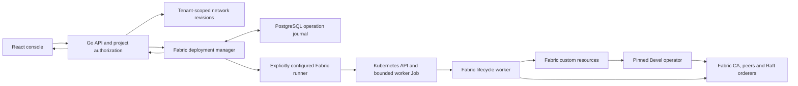
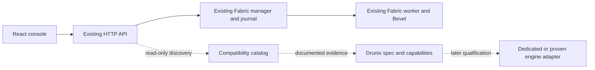

# Drunix discovery and architecture review

Phase 2 implements the [read-only foundation](drunix-foundation.md). The
original proposal and Phase 1 evidence below are retained for comparison.

**Decision proposed, 16 November 2026.** Baseline Sathonate
`1fcff204a8db081ea82271c2a272ac1832903079`. Upstream Drunix `v1.0.0`,
`3fb2b135a5b2adf7e1071d9b1624052a1bbb1772`. This is a source review and
test baseline. [Original architecture proposal](Sathonate_Architecture_Drunix_Review_With_Diagrams.docx).

## 1. Existing Fabric execution

The original current-state diagram is sound at the service level. The journal
and desired network store are distinct dependencies. The Bevel operator
reconciles Kubernetes resources and is not the worker’s transaction gateway.
The inline registry in the long-term diagram should be drawn off the existing
execution path for the first increment.



| Boundary | Actual behavior and source |
| --- | --- |
| Browser | `ProjectGate` selects a server-authorized project. `SmpApp` handles the guided path and `CustomNetworks` handles dynamic configurations. The saved revision is submitted through `api.deploy` with `If-Match` and a revision-bound idempotency key. Status, health and operation history are separate reads. [Project gate](../../fabric-console/src/ProjectGate.tsx#L10) · [Console API](../../fabric-console/src/api.ts#L129) · [Dynamic console](../../fabric-console/src/CustomNetworks.tsx) |
| Admission | OIDC validates identity and checks the project permission and write scope. The handler reads the network from the scoped repository, checks the revision, validates protected-profile access and calls the manager. The read-only EKS authorization check can pass while execution remains disabled. [OIDC](../internal/identity/okta.go) · [Deployment handler](../internal/httpapi/deployment.go#L40) · [Draft persistence](../internal/persistence/postgres.go) |
| Manager and journal | `Start` selects the existing operation flow. Admission checks include the Bevel engine and Fabric domain validation. A prepared operation binds the tenant, record, revision, idempotency key and request against the selected runner. PostgreSQL persists staged operations and supports coordinated recovery. Reuse and retry have different identities. [Manager](../internal/deployment/manager.go#L98) · [Operation admission](../internal/operations/store.go#L168) · [PostgreSQL journal](../internal/operations/postgres.go) |
| Runner and worker | API startup wires the runner explicitly. `bevel` is the saved design's engine, `secure-local` and `secure-eks` are runner modes, and Bevel is the Kubernetes reconciler. The protected runner checks ownership, prepares isolation and submits a bounded worker Job. The worker handles Fabric identities, channels, chaincode and transaction evidence. EKS adds a runtime binding and preflight. [Startup](../cmd/fabric-api/main.go#L188) · [Runner interface](../internal/deployment/runner.go#L61) · [Protected runner](../internal/deployment/secure_runner.go#L195) · [Worker](../internal/kubernetesfabric/worker.go#L265) |
| Lifecycle and recovery | Dynamic routes own configuration revisions and changes. Lifecycle endpoints use their existing action-specific previews, permissions and approvals. Recovery adopts only eligible operations and uses the saved binding. Keep task-specific fencing, retry behavior, retained-data deletion, backup behavior and unrelated local/legacy runners intact. [Dynamic routes](../internal/httpapi/dynamic.go) · [Lifecycle](../internal/httpapi/lifecycle.go) · [Recovery and cancellation](../internal/deployment/recovery.go) · [Acceptance gates](rc1-readiness.md) |

The diagram is the protected Kubernetes path, with local Kubernetes execution
qualified in prior sprint evidence. Other modes and EKS qualification have
separate prerequisites. No cloud or retained-cluster actions were taken here.

## 2. Drunix evidence and compatibility

NPCI publishes Drunix as an Apache-2.0 Fabric fork. The official release
advertises Fabric 2.5.x backward compatibility. The review verifies that
statement exists and that the sample shares Fabric concepts. It establishes
no mixed-network, data migration, operator or production interoperability.
[Release](https://github.com/npci/drunix/releases/tag/v1.0.0) ·
[License](https://github.com/npci/drunix/blob/v1.0.0/LICENSE).

| Area | Verified from source | Qualification needed |
| --- | --- | --- |
| Topology and transport | Sample documentation describes two peer organizations, one lite peer, one committing peer and a validation service per organization, with a single-node Raft ordering service. Compose configuration and channel profiles confirm the example orientation. | Immutable image inventory, Kubernetes manifests, service discovery, topology constraints and multi-orderer quorum tests. The sample is insufficient for HA. |
| Identity and policy | Sample enrollment supports cryptogen or Fabric CA. Peer configuration and channel config use MSP, X.509 TLS and Fabric-style endorsement policies. | Distinct service identities, trust roots and rotation, verified mTLS between split roles, and an isolated tenant trust boundary. The sample enrollment defaults are development fixtures. |
| Transaction lifecycle | Lite peer endorses against state. Ordering batches requests into blocks. Committing peer coordinates stateless validation and MVCC, persists validated ledger and state, and exposes commit evidence. The sample includes channel and chaincode lifecycle commands. | Verify endorsement routing, invalid transaction handling, event/query compatibility and exact tx ID, validation code, height and readback on intended committing peers. Running pods alone establish no transaction guarantee. |
| Storage | Architecture describes YugabyteDB SQL state, existing LevelDB/CouchDB support and shared KeyDB transient state. The sample defaults to YugabyteDB and wires KeyDB and SQL separately from persistent peer/orderer volumes. | Establish exact role-by-role requirements per qualified storage profile, private data semantics, encryption, ownership, backup consistency across stores and recovery after lag or loss. Control-plane PostgreSQL has a separate purpose. |
| Existing Bevel | Pinned checkout `cd236ccc61d1d159b3dadb4625d08bb5682a8451` exposes Fabric peer image and state DB configuration, including a PG enum. The reviewed peer shape does not establish independent lite/committing/validation roles or reconciliation of Drunix's additional stores. | No image substitution or qualification claim. Test the exact CRD/chart, readiness, policy, upgrades and storage behavior against a pinned Drunix configuration before selecting Bevel. |

Sources: [upstream design](https://github.com/npci/drunix/blob/v1.0.0/docs/drunix-arch.md),
[sample procedures](https://github.com/npci/drunix/blob/v1.0.0/drunix-network/test-network/README.md),
[sample Compose](https://github.com/npci/drunix/blob/v1.0.0/drunix-network/test-network/compose/compose-test-net.yaml),
[MSP and IaC sample](https://github.com/npci/drunix/tree/v1.0.0/drunix-network/test-network/organizations),
[peer configuration](https://github.com/npci/drunix/blob/v1.0.0/drunix-network/config/peer/core.yaml),
[Raft configuration](https://github.com/npci/drunix/blob/v1.0.0/drunix-network/test-network/configtx/configtx.yaml),
[pinned Bevel API](https://github.com/hyperledger-bevel/bevel-operator-fabric/blob/cd236ccc61d1d159b3dadb4625d08bb5682a8451/pkg/apis/hlf.kungfusoftware.es/v1alpha1/hlf_types.go).

| Protocol and version | Engine | Target | Discovery status and execution |
| --- | --- | --- | --- |
| Fabric 2.5.15 | Pinned Bevel and current protected runner | Previously qualified disposable kind profile | Existing execution remains governed by current gates. Catalog can display prior evidence. |
| Fabric 2.5.15 | Pinned Bevel and secure EKS runner | Approved EKS qualification target | Adapter and fixtures exist. Live EKS remains pending. |
| Drunix 1.0.0 | Upstream Compose sample | Disposable local Docker | Upstream reference workflow verified by reading source. Sathonate execution unavailable. |
| Drunix 1.0.0 | Bevel or dedicated adapter | Kubernetes | Unknown. Deny execution until a pinned pair is qualified. |
| Drunix, Fabric or future protocols | Falcon | Any | No validated combination in this review. Deny execution. |
| Besu, Sawtooth or other | Any | Any | Outside the discovery scope. Deny execution. |

## 3. ADR proposal · preserve Fabric and add a read-only catalog

**Context.** `deployment.Request` and `Outcome` use Fabric types. Extending
the existing manager to dispatch arbitrary payloads now would touch lifecycle,
queue recovery, idempotency and saved revision semantics before a second
executable protocol has demonstrated those needs.

**Decision.** Keep the Go monolith and explicit composition in
`cmd/fabric-api`. Add a read-only catalog once discovery is accepted. The
catalog describes exact protocol, protocol version, engine, engine version or
artifact digest, and target profile. It reports support per operation and links
to evidence. Unknown tuples are unavailable. Catalog entries cannot start
execution or broaden tenant/project access. Keep specification validation and
transaction evidence with the protocol. Keep Kubernetes materialization and
observation with the approved engine/pair adapter.



**Alternatives.** A universal runtime interface now would freeze assumptions
from Fabric before Drunix is runnable. A fork of the API would duplicate
identity and recovery. Treating Drunix as a Fabric image variant would miss
storage and node-role differences. Defer each option.

**Proposed contracts, for review only.** Register descriptors as values.
Start with a single protocol interface where discovery needs validation.
A Kubernetes target profile is a reference, with credentials resolved by
the operator boundary. Keep payload and outcome typed in their owning
packages. Any future engine contract should expose preflight separately from
mutation. Define lifecycle interfaces per supported operation after observing
both implementations, with explicit cancellation and observation boundaries.

```go
type ProtocolID string
type EngineID string
type Capability string

type DeploymentIdentity struct {
    Protocol ProtocolID
    ProtocolVersion string
    Engine EngineID
    EngineVersion string
    TargetProfile string
    SpecDigest string
}

type Protocol interface {
    ID() ProtocolID
    Capabilities() []Capability
    Validate(rawSpec []byte) error
}
```

Durable execution may later bind the tuple to immutable artifact digests,
exact target identity, tenant/project, saved revision and operation ID using
the trusted control plane. Retrying must reuse the original tuple and digest.
Preserve Fabric record defaults and decoding. No data rewrite or automatic
migration belongs in the catalog increment.

## 4. File-by-file plan and dependency boundaries

| Phase | Proposed files | Gate and rollback |
| --- | --- | --- |
| Discovery (this branch) | `docs/drunix-discovery.md` | Source references, diagrams, baseline. Revert this document independently. |
| Foundation, after review | `internal/compatibility/catalog.go`, `catalog_test.go` | Exact tuple keys, deterministic output, duplicate rejection, unsupported pair and capability denial. Pure package with no deployment or HTTP dependency. |
| Foundation, after review | `internal/blockchains/drunix/spec.go`, `validate.go`, `capabilities.go`, corresponding tests and `testdata/` | Versioned spec and strict validation fixtures only. No Kubernetes mutation, dependency on Fabric internals, or upstream runtime imports. Extract a small shared type package only when a second caller needs it. |
| Optional read-only integration | New `internal/httpapi/compatibility.go`, tests and explicit wiring in `cmd/fabric-api/main.go` | Feature-gated authenticated catalog route, default off. No path into `deployment.Start`. Browser display can follow with its own feature-gated route and mock-based tests. Remove the registration to roll back. |
| Later execution qualification | `internal/engines/<qualified-engine>/` and `internal/integrations/drunix_<engine>/` where translation is needed | Separate review. Qualify identities, network policy, persistence, ledger, cancellation, retries and recovery on a disposable target. Disabled by default. Current Fabric manager, worker, engine routing and SQL schema remain untouched during the foundation. |

Dependencies point from composition to concrete modules. Catalog receives
descriptors, Drunix owns its versioned spec, and an engine/pair adapter may
consume a validated spec. Protocol packages do not import other protocols,
engine packages do not import peer engines, and shared contracts import
neither. Compile and review dependency edges before adding shared lifecycle
types.

## 5. Risks and regression baseline

| Risk | Required control |
| --- | --- |
| Compatibility claim becomes an execution decision | Exact tuple and operation evidence. Unauthorized, unknown and disabled paths deny execution. |
| Existing operations get routed differently after restart | Keep legacy routing and payloads intact. Pin artifact versions and exact target on any future execution. Exercise legacy revisions, idempotency replays, and crash adoption across releases. |
| Split-role storage diverges or loses private data | Test both stores, committer lag, valid/invalid commit behavior and restore on a disposable target. Require ledger and readback evidence. |
| Identity or tenant grant is confused across protocols | Keep server-owned authority and protocol identities separate. Test cross-tenant/project denials, stale approvals, certificate validation, and redacted diagnostics. |
| Upstream sample is treated as deployable platform | Review release artifacts and support policy, build provenance, storage and license obligations before a Phase 2 experiment. Kubernetes production support stays open. |

Baseline commands use local tests and fixtures. `go test ./...`,
`go vet ./...`, `python -m unittest discover -s tools/sprint3 -p 'test_*.py'`,
and console `npm test` and `npm run build` passed on the baseline. The
frontend build emitted its existing chunk-size warning. Environment-dependent
PostgreSQL, browser and live Kubernetes/Fabric qualification were outside this
fresh baseline. Use
[Sprint 4](sprint4-local-platform.md), [Sprint 3](sprint3-local-secure-eks.md)
and [RC1 readiness](rc1-readiness.md) to trace previous evidence and pending
gates. Before enabling any new registry route, repeat baseline and add route,
isolation, payload stability and no-dispatch contract tests. Before any
execution routing, repeat disposable Fabric deploy, expansion, committed
transactions, retries, recovery and retained-data deletion.

**Review verdict:** GO for this discovery result. REVISE the long-term
diagram to reflect the initial read-only catalog. NO-GO for Drunix execution
or engine compatibility claims. Phase 2 requires explicit approval.
