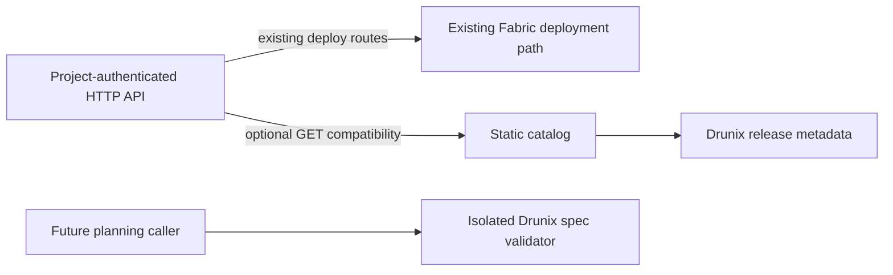

# Drunix foundation

Phase 2 adds a read-only compatibility catalog and a planning validator
for Drunix `v1.0.0` at `3fb2b135a5b2adf7e1071d9b1624052a1bbb1772`.
See the [architecture review](drunix-discovery.md) for the Fabric call path,
upstream evidence and proposed ADR.

## Read-only discovery

Start a configured Sathonate API with `-compatibility-catalog` to enable
`GET /api/v1/compatibility`. The switch defaults off. Requests go through
existing API authentication and need a server-authorized project. Authorized
projects receive the same static catalog, without tenant data. The response
contains `protocols` and `combinations` in a fixed order. Drunix capability
entries point to release-pinned upstream source and describe capabilities of
that source. They convey no Sathonate execution permissions.

The catalog compares the exact protocol, protocol version, engine, engine
version or artifact identity, and target profile. Go callers can use
`compatibility.Decide`. A tuple absent from the catalog is `unsupported`.
Registered entries are `qualified` for the recorded local Fabric fixture,
`pending` for the scoped Fabric EKS qualification, or `reference-only` for
the upstream Drunix Docker Compose sample. These are evidence labels. The
catalog covers the protected profiles listed here and does not enumerate
every existing Fabric execution mode.



No frontend navigation, persistence or execution changes are needed for
discovery. Switching the option off removes the HTTP route.

## Planning specification

`drunix.Decode` accepts one JSON object, up to 64 KiB, and rejects unknown
fields and trailing JSON. `NetworkSpec.Validate` checks an already decoded
value. The isolated schema intentionally models the upstream reference
topology. The constraints describe the supported planning profile rather than
general Drunix limits. A valid object does not establish deployability.

```json
{
  "apiVersion": "drunix.sathonate.io/v1alpha1",
  "version": "1.0.0",
  "name": "reference-net",
  "consensus": "raft",
  "orderer": { "id": "orderer", "mspId": "OrdererMSP" },
  "organizations": [
    {
      "id": "north",
      "mspId": "NorthMSP",
      "litePeer": "lite-north",
      "committingPeer": "commit-north",
      "validationService": "validate-north",
      "stateDatabase": "yugabytedb",
      "transientStore": "keydb"
    },
    {
      "id": "south",
      "mspId": "SouthMSP",
      "litePeer": "lite-south",
      "committingPeer": "commit-south",
      "validationService": "validate-south",
      "stateDatabase": "yugabytedb",
      "transientStore": "keydb"
    }
  ]
}
```

Names and component IDs use DNS labels. Component and organization IDs
must be distinct across the design. Each organization and the orderer
have distinct MSP IDs. There is one lite peer, one committer and one
validation service per organization, and one Raft orderer. The profile
allows YugabyteDB and KeyDB only. There are no secret, image, target, or
executable configuration inputs. No HTTP route accepts or stores this spec.

## Implementation decisions and files

| File | Responsibility |
| --- | --- |
| [Drunix spec](../internal/blockchains/drunix/spec.go), [tests](../internal/blockchains/drunix/spec_test.go) | Release-bound type, strict decoding and structural validation |
| [Drunix capabilities](../internal/blockchains/drunix/capabilities.go) | Stable capability IDs with upstream evidence |
| [Compatibility catalog](../internal/compatibility/catalog.go), [tests](../internal/compatibility/catalog_test.go) | Static snapshots and exact tuple decisions |
| [HTTP catalog](../internal/httpapi/compatibility.go), [tests](../internal/httpapi/compatibility_test.go) | Authenticated opt-in static response, with negative authorization and isolation coverage |
| [HTTP wiring](../internal/httpapi/api.go), [options](../internal/httpapi/cloud.go), [CLI flag](../cmd/fabric-api/main.go) | Default-off discovery route outside deployment admission and dispatch |
| [Discovery review](drunix-discovery.md), this page | Architecture, contract and review status |

Catalog values and a standalone validator are sufficient at this stage.
Shared lifecycle interfaces, adapter abstractions and persisted deployment
identity can follow a proven second runtime. The catalog imports only the
Drunix metadata module. It has no dependency on the Fabric runner,
deployment manager, persistence, or Kubernetes clients.

## Open gates

The upstream sample and NPCI's Fabric 2.5.x compatibility statement are
source evidence. Mixed Fabric/Drunix execution, operator reuse, Falcon
compatibility, Kubernetes packaging, production storage and HA, private
state behavior, upgrade, recovery and new transaction evidence remain
unverified. Phase 2 provisions no infrastructure and implements no lifecycle.
See the [pinned NPCI release](https://github.com/npci/drunix/releases/tag/v1.0.0)
and [sample](https://github.com/npci/drunix/blob/v1.0.0/drunix-network/test-network/README.md).

## Regression results

- `go test ./... -count=1` and `go vet ./...` passed.
- The offline Sprint 3 Python suite passed all 27 tests.
- The console passed all 31 Vitest tests and built successfully. Vite
  reported its existing large-chunk warning.
- API tests used the existing controlled OIDC issuer fixture. No live
  deploy, PostgreSQL integration fixture or browser session was exercised.
