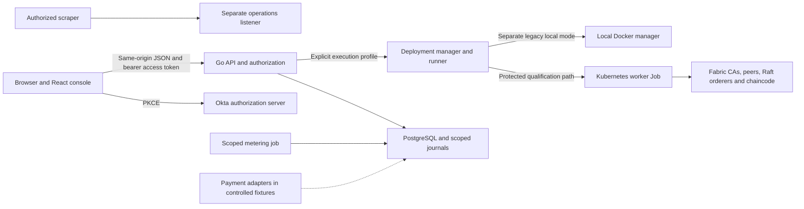
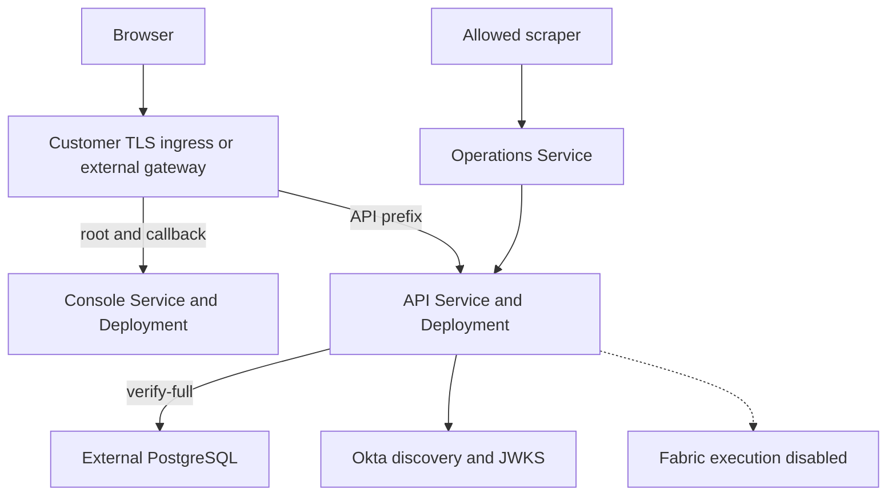

# 01 · System design

[Handbook](README.md) · [Flows](03-workflows.md) · [Service inventory](02-codebase.md)

## High-level design

Sathonate accepts desired Hyperledger Fabric network designs, validates them, coordinates explicitly enabled deployment adapters, and records observed results and operation history. React renders these states independently. A saved design or an accepted operation is insufficient evidence of Fabric health.

## Low-level service boundaries

| Boundary | Responsibility | State and failure |
|---|---|---|
| Console and static server | `AuthGate`, `ProjectGate`, `SmpApp` and the shared API transport. Static server serves the callback SPA and assets. | Browser token in memory. Workspace reopens from server operations and drafts. Console API path is routed separately. |
| Go API | Startup chooses database/auth/runner. `NewConfigured` registers routes, Host/Origin checks and JSON contract. | PostgreSQL is required for production. Errors fail closed on missing trust or grants. |
| Deployment manager | Binds jobs to tenant/project-derived scope, record, revision, runner and approval. | Operation journal and observed result are separate rows. Reconciliation depends on the runner and a durable binding. |
| Worker and Fabric | Worker applies protected workload/material configuration, channel operations, chaincode and verification. | Namespace, Secrets, PVCs, Jobs and Fabric ledgers. The worker checks target ownership and records completion. |
| Billing and maintenance | Customer ledger, reviewed operations, public certificate inspection and encrypted recovery tools. | Payment ingress and production execution are disabled. Recovery uses operator-controlled targets and artifacts. |

Sources and checks are indexed by [package and file](02-codebase.md). Main entry points are [API startup](../../cmd/fabric-api/main.go), [route registration](../../internal/httpapi/api.go), [runner interface](../../internal/deployment/runner.go), [worker](../../internal/kubernetesfabric/worker.go), and [console server test](../../cmd/fabric-console-server/main_test.go).

## Customer Helm profile boundary

The chart packages stateless API and console. Customer-managed PostgreSQL and its CA/DSN Secret, immutable images, HTTPS routing and optional monitoring are prerequisites. The customer preview is a protected inventory and digest check. The chart does not qualify a customer Fabric actuator. See [Helm workload templates](../../deploy/charts/sathonate/templates/workloads.yaml), [network policy and monitoring](../../deploy/charts/sathonate/templates/network.yaml) and [RC1](../rc1-readiness.md).
