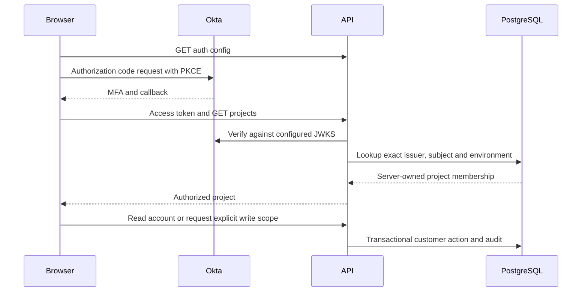
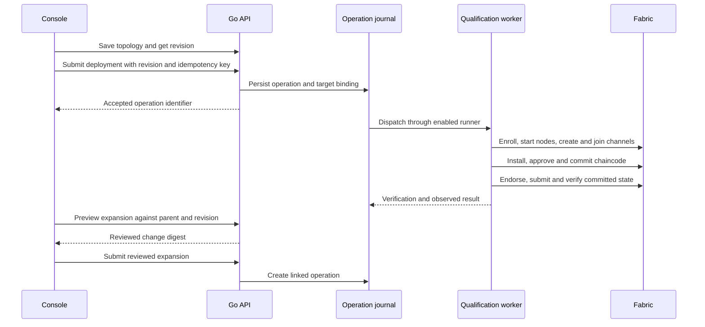
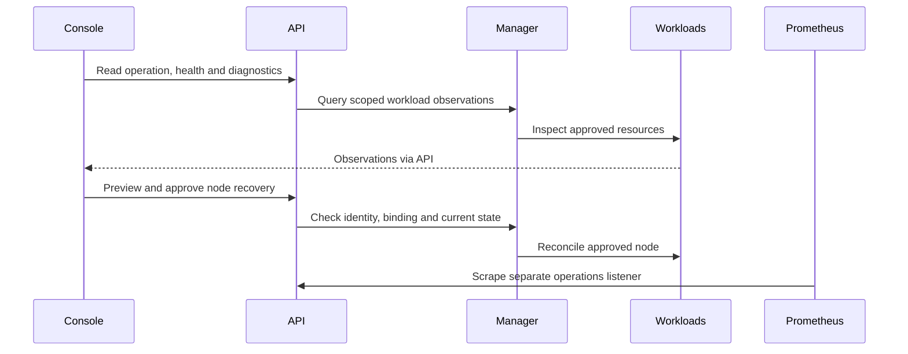
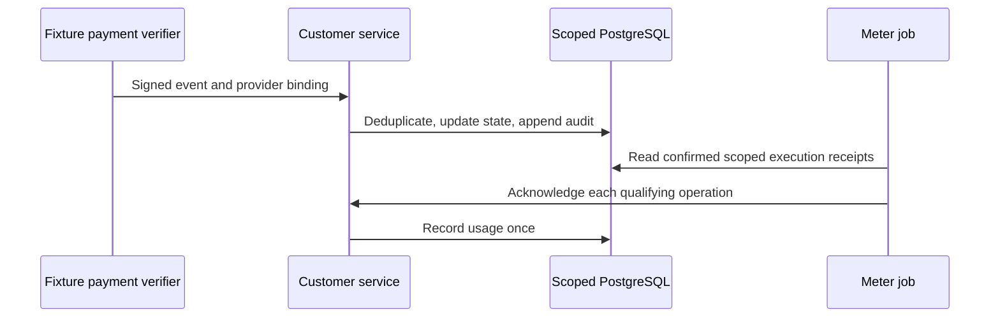
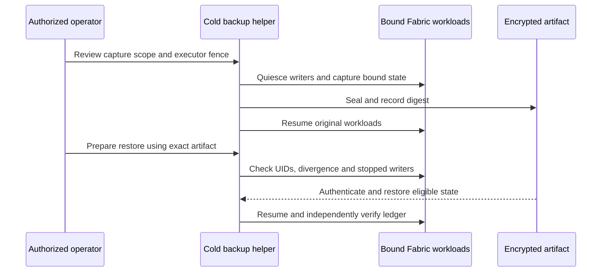
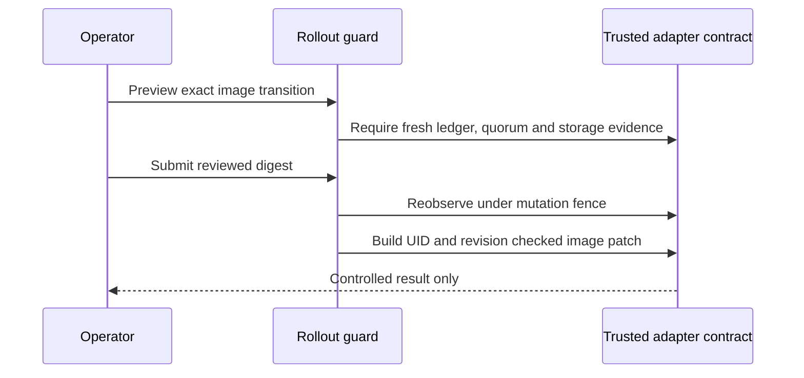

# 03 · Workflow sequences

[Handbook](README.md) · [API](05-api.md) · [Recovery](09-operations.md)

## Authentication and onboarding

**Why.** Establish verified identity before selecting a server-owned project and before any tenant-wide account administration.

`AuthGate` initializes Okta and uses a memory token manager. `Authenticator.Middleware` validates the access token, checks assurance and route permission, and derives the project scope from the approved grant. The account owner must separately match issuer and subject. The admin CLI bootstraps an existing owner grant. A viewer may accept only their own pending invitation, without gaining a Fabric grant. Missing grants stop at project selection. Failed writes can be retried with the same idempotency key and body. [Identity](../../internal/identity/okta.go) · [Customer actions](../../internal/customer/actions.go) · [API fixture](../../internal/httpapi/customer_test.go) · [Browser fixture](../../../fabric-console/e2e/customer-pilot.spec.ts).

## Provision, expand and verify transactions

**Why.** Keep design intent, admission, irreversible Fabric configuration and committed-state evidence separate.

1. The domain validator checks identities, references, ordering capability, and desired topology. Target and profile guard dispatch. Customer Kubernetes currently returns a preview only.
2. The manager persists before dispatch. The worker enrolls identities and prepares protected material, deploys orderers and peers, joins channels and commits chaincode.
3. An operation needs actual transaction and peer readback evidence. For supported expansion, `PreviewDynamic` and `ApplyDynamic` bind the parent and digest, then reconcile approved additions and verify again.
4. Stale revision, wrong target, incomplete trust, disagreement or an interrupted worker blocks progress. Inspect the existing operation and receipts. Retry the same approved target through the manager. Once a channel configuration changes, use reviewed forward recovery where rollback is unsafe.

[Manager](../../internal/deployment/manager.go) · [Dynamic changes](../../internal/deployment/dynamic.go) · [Worker](../../internal/kubernetesfabric/worker.go) · [A/B/C evidence](../sprint4-dynamic-acceptance.md).

## Monitoring and recovery

The UI distinguishes recorded history and live observations. Verify workload/PVC identity before and after recovery, then confirm Fabric ledger continuity. A stale preview or unhealthy quorum stops recovery. Metrics are process-wide and use bounded labels. [Workloads](../../internal/httpapi/workloads.go) · [Recovery](../../internal/deployment/node_recovery.go) · [Telemetry tests](../../internal/telemetry/http_test.go) · [Local evidence](../sprint5-acceptance.md).

## Billing, backup, restore and upgrade

Billing events verify signature and customer mapping before changing subscription or invoice state. A replay keeps the original effect. The meter may reread a window after interruption. [Payment](../../internal/customer/payment.go) · [Meter test](../../internal/customer/meter_test.go) · [Commercial workflow](10-commercial.md).

A failed scheduled slot needs review before later slots proceed. Restore verifies original ownership and rejects divergence. Replacement targets require distinct implementation and acceptance. [Cold backup](../../internal/deployment/cold_backup.go) · [Schedule](../../internal/maintenance/schedule.go) · [Sprint 7 evidence](../sprint7-acceptance.md).

Production mutation wiring is blocked. Use the approved release edge and CA enrollment pause when applicable. Never treat a mocked patch as a workload rollout. [Upgrade guard](../../internal/rollout/upgrade.go) · [Mocked patch test](../../internal/rollout/patch_test.go).
