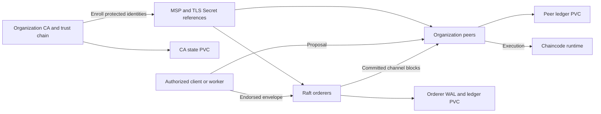

# 04 · Fabric and Kubernetes

[Handbook](README.md) · [Provisioning sequence](03-workflows.md) · [Security](08-security.md)

The desired network model represents organizations and their MSP IDs, nodes, channels, ordering consensus, and optional configuration for authorities, placement, resources, storage, anchors and chaincode. A Fabric CA enrollment supplies signing or TLS material under explicitly configured trust. MSP roots and signing identities establish authorization. TLS endpoint trust protects transport and does not replace MSP policy. Peers endorse and maintain ledger state. Raft orderers commit blocks through a voting majority. Channels have distinct members, configuration and ledger histories.

The protected local worker uses namespace-owned CA, peer and orderer resources, scoped Services, Secret references and PVCs. The channel participation path uses approved orderer admin identities. Initial channel setup, anchor changes, organization additions and Raft consenter changes are separate transitions with different signing and quorum requirements. Chaincode flows install exact package identities, approve definitions for the relevant organizations and commit a sequence, then verify actual invocation and cross-peer readback. A chaincode definition revision and a package change are distinct.

**Identity preservation.** Recovery reconciles a bound workload and compares identities and storage ownership. Expansion must keep pre-existing identities and data unless a separately approved transition requires a change. Local PV identity and scheduling constraints matter when a node is lost. The disposable multi-node plan explicitly distinguishes stateless rescheduling from original-local-PV recovery. BFT is design-only where accepted by validation.

**Sources and checks.** [Network model](../../internal/domain/spec.go) · [Configuration](../../internal/domain/configuration.go) · [Topology validation](../../internal/topology/contract.go) · [Worker](../../internal/kubernetesfabric/worker.go) · [Sprint 4 topology and transaction evidence](../sprint4-dynamic-acceptance.md) · [Sprint 6 storage and quorum limitations](../sprint6-acceptance.md).

## Runtime topology and persistent ownership

The diagram is schematic. The customer specification supplies node count, organizations and channels. Multiple channels can share nodes while keeping separate configuration and ledger state. Persistent stores and runtime signing material remain bound through a restart. PVC backup captures data, but still needs a trustworthy copy of control-plane ownership and identity references to be usable.

| Object or artifact | What to compare during a change |
|---|---|
| Fabric CR, Deployment, Service and Job | Namespace UID, workload owner, exact component ID, desired image, current rollout state and observed endpoint. |
| Secret reference | Public certificate fingerprint, issuer chain, intended use and workload reference. Keep private contents outside receipts. |
| PVC and volume | Claim UID, capacity, class, placement/affinity, bound volume identity and expected recovery semantics. |
| Channel | Membership, Raft voters, policy sequence, MSP roots and block/ledger agreement before and after change. |
| Chaincode | Approved package hash, channel definition name/version/sequence and actual peer readiness, followed by a newly committed transaction. |

Do not infer quorum from the number of ready pods alone. The intended channel's active voters and majority must be checked. A peer can be process-ready while still catching up or missing a required package.
