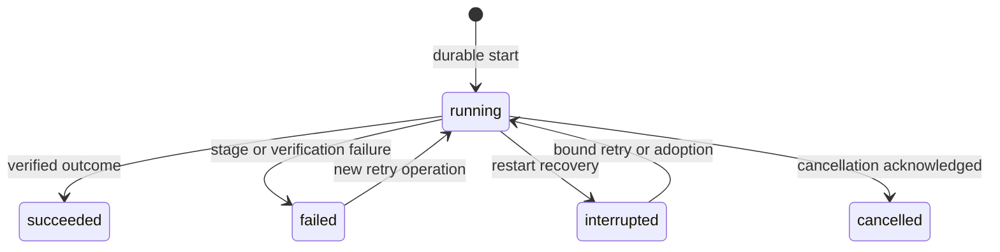

# 05 · API and orchestration

[Handbook](README.md) · [Complete route index](catalog-api.md) · [Database](06-postgres.md)

The API uses versioned same-origin JSON. `NewConfigured` owns the routing table and Host, Origin and content-type checks. The process-level authentication middleware supplies the verified principal. Route handlers apply operation-specific permissions and derive scope from the principal. No arbitrary tenant selector establishes ownership.

| Family | Contract and durable effect |
|---|---|
| Metadata, identity, projects | `GET /api/v1/auth/config` exposes public auth settings. `GET /api/v1/projects` returns the approved project scope. The identity probe is limited to explicitly enabled qualification. |
| Drafts and plans | Network specs are typed JSON. Create returns a draft and revision. Updates and reviewed operations bind `If-Match` to the current revision. Validation and plan routes do not provision. Draft archival is separate from runtime deletion. |
| Deploy, expand, lifecycle | Send current revision and idempotency key where required. A deployment returns 202 and an operation identifier. Dynamic and lifecycle changes require a parent-bound preview digest and supported runner. |
| Observe, cancel, retry | Read scoped operation status, events with a cursor, diagnostic receipts and workload observations. Cancellation and recovery are distinct permissions. Retry checks failed/interrupted state and recorded target binding. |
| Recovery and retained-data deletion | Preview and bind the operation and resource identities. Use explicit reviewed approval. Supported cleanup removes owned workloads under a fence while preserving applicable data and identities. |
| Customer | Account and plan summary, owner actions, exact-recipient invitation acceptance, customer preflight. See the [pilot API contract](../sprint9-customer-pilot.md) and [RC1 preview contract](../rc1-readiness.md). |

**State and concurrency.** `Manager.Start` persists prepared state before dispatch. Journal stages record events and culminate in a terminal outcome. A running-operation index fences concurrent operations per scoped network and the idempotency index binds requests. Snapshot verification, observed state and journal completion are separate; a interrupted write requires reconciliation. An ordinary pilot deployment retry requires entitlement. Separately authorized node recovery can continue despite billing state. A production customer executor remains disabled.

**Failure handling.** 401 means authentication failed, 403 permission or entitlement denied, 404 missing/disabled resources, 409 stale revision or conflicting operation, 428 missing required revision and 503 unavailable functionality or dependencies. Some handlers map invalid runtime observations to 422. Never retry with a different target or new key solely to bypass an ambiguous result. Inspect the original receipt and scope first.

[Handlers](../../internal/httpapi/api.go) · [Journal](../../internal/operations/store.go) · [Deployment manager](../../internal/deployment/manager.go) · [API revision/idempotency tests](../../internal/httpapi/deployment_test.go) · [Customer tests](../../internal/httpapi/customer_test.go).

## Operation state and transitions

The retry arrows describe operator flow. A new retry has its own operation identifier and references the predecessor. Depending on runner and durable receipt, restart may instead reconcile an existing Job. Check actual operation state and its events before making another request.

### Representative request shapes

| Operation | Required inputs | Returned or durable information |
|---|---|---|
| Save network | Typed `FabricNetwork` desired JSON; update includes `If-Match`. | Draft ID, desired topology and revision. |
| Deploy | `POST /api/v1/networks/{id}/deploy`, revision, `Idempotency-Key`, JSON options object. | 202, operation receipt and a Location for its status. |
| Dynamic expansion | Preview against current revision and `parent` query parameter. Submit `parentOperationId` and `approval` with current revision and idempotency key. | Preview digest, then a linked operation. |
| Node recovery | GET preview for the selected node on a recorded deployment. POST body contains `node` and `approval`; use the approved operation's scope. | Approval-bound recovery operation and subsequent observation. |
| Read events | `GET /api/v1/operations/{operationId}/events` with optional `after` cursor. | Items, next cursor and status. |
| Customer preflight | Exact customer-network ID, `If-Match`, entitled project and registered target. | Target ref, draft revision, storage plan, binding digest and execution disabled. |

[Deploy handler](../../internal/httpapi/deployment.go) · [Expansion handler](../../internal/httpapi/dynamic.go) · [Node recovery handler](../../internal/httpapi/node_recovery.go) · [Local and event handlers](../../internal/httpapi/local.go).
