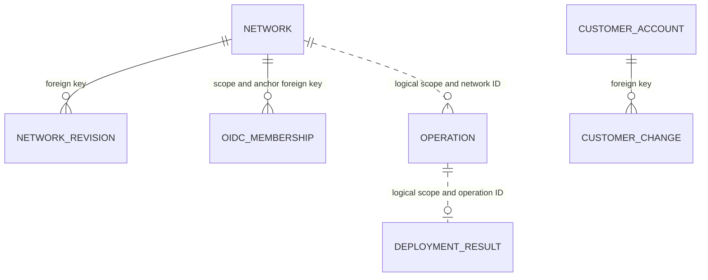

# 06 · PostgreSQL

[Handbook](README.md) · [Authorization](08-security.md) · [Recovery](09-operations.md)

`Database.Migrate` explicitly applies SQL constants owned by persistence, operations, maintenance, identity, audit and customer packages. Runtime startup checks role and TLS constraints. The local file repository is for development. Use verified TLS and separate administrative, API, executor and meter roles as applicable.

| Table | Ownership and policy |
|---|---|
| `sathonate_networks`, `sathonate_network_revisions` | Composite scope and record/revision identities. Active key uniqueness. Forced RLS binds transaction-local `sathonate.tenant_id`. |
| `sathonate_operations`, `sathonate_deployments` | Journal and observed result. Scoped by `sathonate.tenant_id`; the explicit executor role has a separate policy branch for reconciliation. |
| `sathonate_oidc_memberships` | Environment, issuer, subject, tenant and project key. Scope and anchor reference an existing network. Subject/environment session settings constrain read access; identity administrator controls writes. |
| `sathonate_maintenance` | Scoped maintenance record with bound approvals and checkpoint state. |
| `sathonate_audit_events` | Append and read policies bind `sathonate.audit_scope`; production runtime lacks mutation of existing events. |
| `sathonate_customer_accounts`, `sathonate_customer_changes` | Tenant-level account JSON and transactionally appended change IDs/digests. `sathonate.customer_tenant` scopes both. Provider reference is unique and separately provisioned. |

The project storage scope is derived by `Principal.StorageTenant` and differs from the tenant-wide billing scope. Customer updates lock the account row, check existing change identity, mutate, append audit and commit. An unsuccessful transaction can replay; a changed payload with an existing key conflicts. Meter privileges allow reading source journal rows and writing only allowed billing fields. PostgreSQL restore and Fabric ledger restore are separately qualified.

[Migration assembly and repository](../../internal/persistence/postgres.go) · [Membership SQL](../../internal/persistence/oidc_memberships.go) · [Journal SQL](../../internal/operations/postgres.go) · [Audit SQL](../../internal/audit/postgres.go) · [Maintenance SQL](../../internal/maintenance/postgres.go) · [Customer SQL](../../internal/customer/postgres.go) · [Restricted TLS/RLS fixture](../../internal/persistence/production_docker_test.go).
