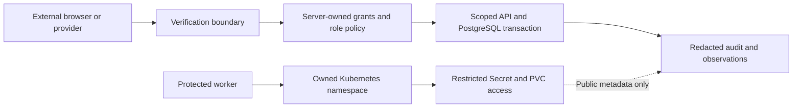

# 08 · Security

[Handbook](README.md) · [Authentication flow](03-workflows.md) · [Database](06-postgres.md)

**Identity.** Okta mode verifies the exact HTTPS issuer and JWKS origin, access token audience, client, time constraints, approved MFA assurance and required scopes. Authorization derives from server-owned issuer/subject/environment memberships and roles. Customer ownership is a distinct account authority. Read-only sign-in requests read access initially. Customer administration explicitly requests write scope. Local bearer grants hash token material server-side and require the isolated local profile. Production must never use legacy loopback identity.

**Trust boundaries.** Browser state, draft JSON, webhook requests, and Kubernetes observations are distinct inputs. Do not accept inline infrastructure credentials or executable templates from customers. Runtime passwords and private keys belong in protected Secrets or local protected files. Helm uses references, not credential values. Verify external material and namespace ownership before reconciling. A dashboard or public CR must never expose key data.

**Lifecycle.** Public certificate inspection verifies an explicit root chain, endpoint and server EKU. Maintenance records use bound, reviewed checkpoints. Immutable peer TLS material and crash recovery have local qualification evidence for that scope only. MSP signing, CA issuer and consenter rotation have separate trust and quorum requirements. Production mutation wiring and incident remediation remain open.

**Audit and response.** Durable project audit and customer change journals are scoped. Use redacted metadata and public fingerprints for incident investigation. Do not replay exposed material. Historical remediation requires inventory correlation, incident owner approval, a rehearsal, rotation per credential class, stale-identity rejection and independent review.

[OIDC checks](../../internal/identity/okta.go) · [Local grants](../../internal/identity/local_tokens.go) · [Audit](../../internal/audit/postgres.go) · [Certificate verification](../../internal/maintenance/certificate_health.go) · [Rotation tests](../../internal/maintenance/rotation_test.go) · [Historical remediation](../sprint7-historical-credential-inventory.md).

## Authorization and credential flow

**Failure boundary.** A successful IdP sign-in does not establish project membership. A valid project grant does not authorize billing ownership. A successful chart render does not establish CNI enforcement or certificate trust. An accepted preview does not authorize a stale apply. Each check is performed at its own boundary, and diagnostics preserve only the minimum redacted data.
